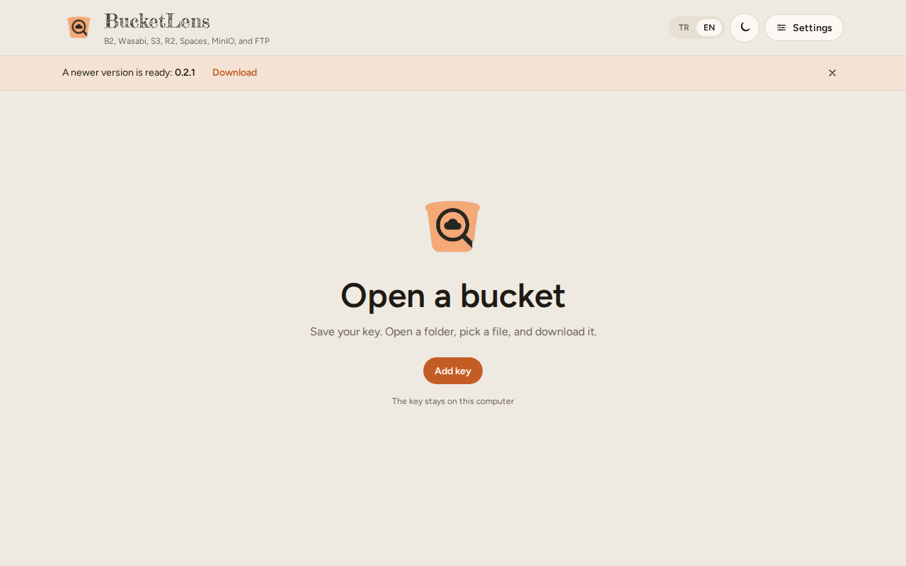
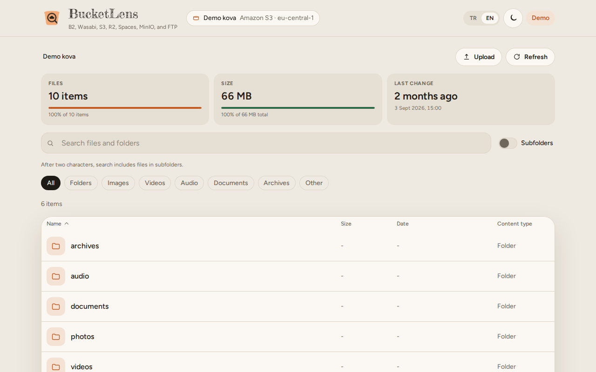
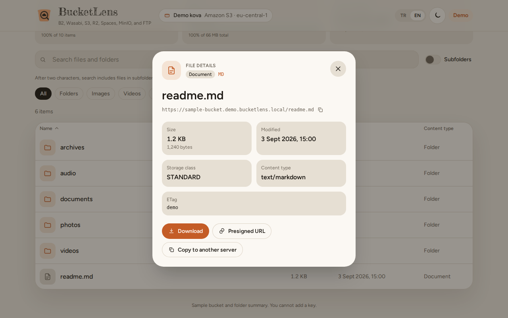
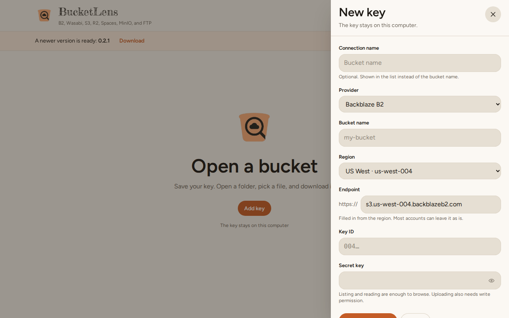

# bucket-lens

[Türkçe](README.md) · **English**

A desktop app for files in Backblaze B2, Wasabi, Amazon S3, Cloudflare R2, DigitalOcean Spaces, MinIO, or FTP buckets. Folder summary, search, type filters, and download stay on one screen. You can give each saved key an optional name. The interface is in Turkish and English, with light and dark appearance.

The key stays on this computer.

## Interface

Welcome. The bucket opens from here when there is no key yet.

With a bucket open, the folder summary, search, subfolder scan, and type filters stay on the same screen.

Clicking a file shows its size, date, storage class, and content type in a window. The path can be copied. Download starts from this window.

Keys live in the panel that opens from the right. You can name a connection. A new key starts by choosing a provider; R2, Spaces, and MinIO are in the list. The region and endpoint fill in from that choice. Leave the secret field empty when a stored secret should stay as it is.

To refresh the screenshots: `pnpm screenshots` (runs a production build first and uses an empty temporary key store).

## Download

Installers are on [GitHub Releases](https://github.com/BeratKARATAS53/BucketLens/releases).

- Windows: an installer
- Debian and Ubuntu: a deb package
- Other Linux: one file, nothing to install

On Linux, GNOME Keyring or KWallet must be open in the session so the key is still there after a restart. The key needs permission to list and read objects.
