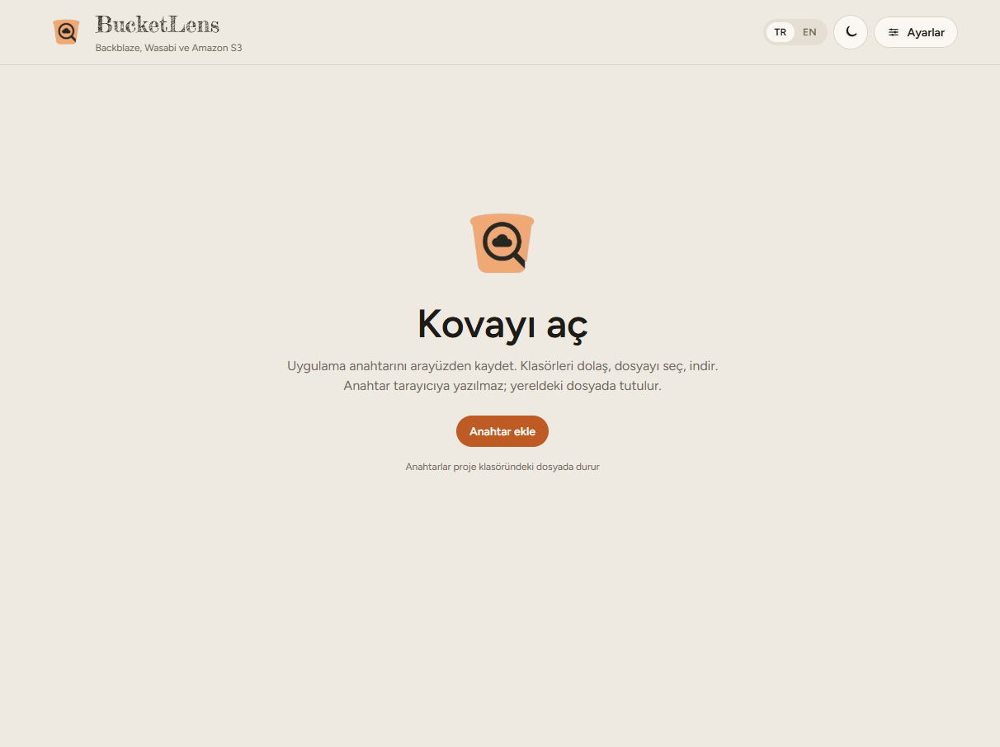
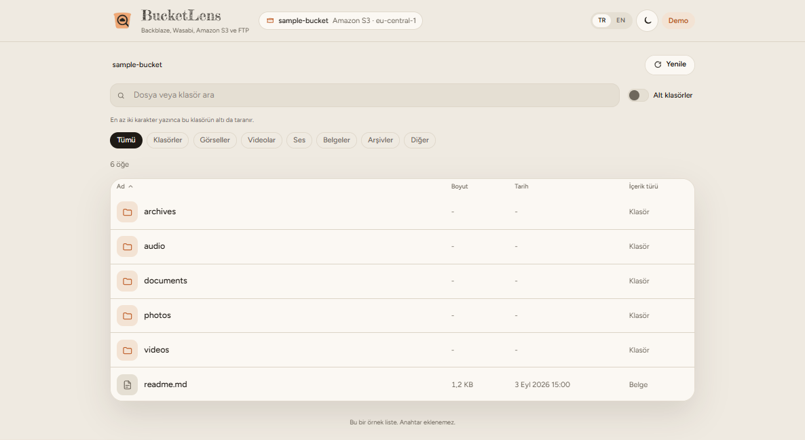
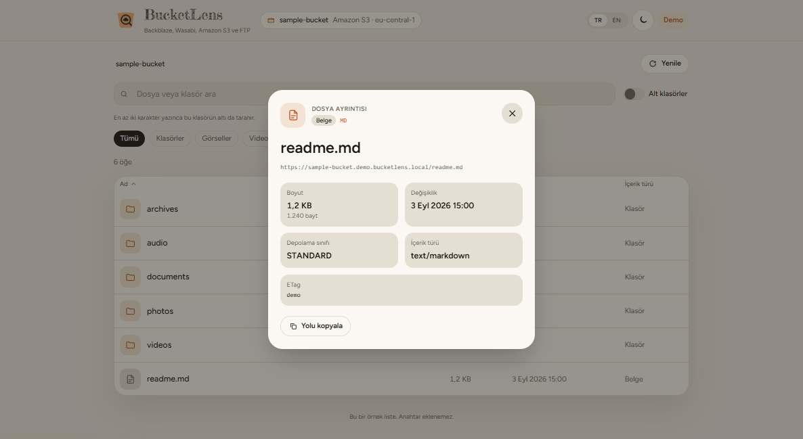
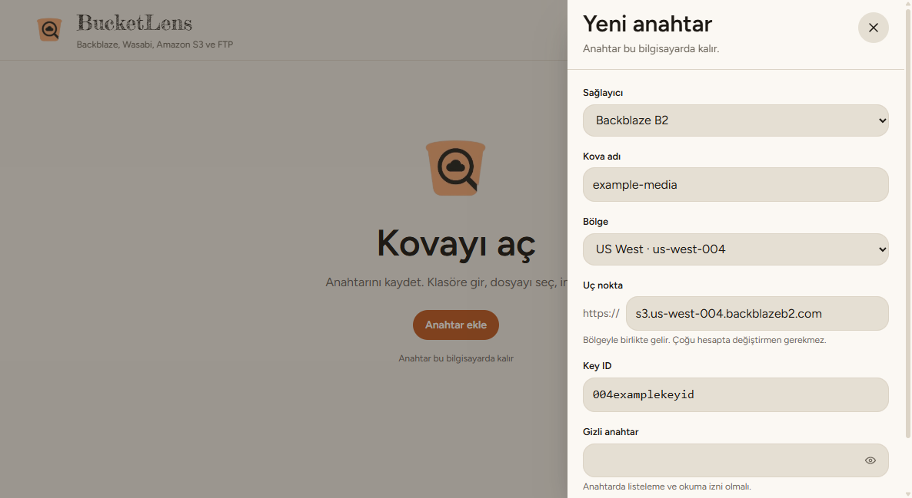

# bucket-lens

**Türkçe** · [English](README.en.md)

Backblaze B2, Wasabi ve Amazon S3 kovalarındaki dosyalara bakmak için masaüstü uygulaması. Klasörlerde gezinir, dosyaları listeler, ada göre arar, türe göre süzer ve indirir. Bir dosyanın ayrıntısı pencerede açılır. Arayüz Türkçe ve İngilizce çalışır; açık ve koyu görünüm vardır.

Anahtarın bu sayfada durmaz. Kurduğun uygulamada, senin bilgisayarında kalır.

## Arayüz

Karşılama. Anahtar henüz yokken kova buradan açılır.

Kova açıkken klasörler, arama, alt klasör taraması ve tür süzgeçleri aynı ekranda durur.

Bir dosyaya tıklanınca boyut, tarih, depolama sınıfı ve içerik türü pencerede görünür. Yol, uç noktayla birlikte kopyalanır. İndirme bu pencereden başlar.

Anahtarlar sağdan açılan panelde tutulur. Yeni anahtarda sağlayıcı seçilir; bölge ve uç nokta ona göre dolar. Kayıtlı gizli anahtarı değiştirmek istemezsen alan boş bırakılır.

## İndirme

Kurulum dosyaları [GitHub Releases](https://github.com/BeratKARATAS53/BucketLens/releases) sayfasındadır.

- Windows: tek tıkla kurulan exe
- Debian ve Ubuntu: deb paketi
- Diğer Linux: kurulumsuz AppImage

Linux’ta anahtarın yeniden başlatmadan sonra durması için oturumda GNOME Keyring veya KWallet açık olmalıdır. Kayıt öncesinde anahtarın nesneleri listeleme ve okuma izni olmalı.
